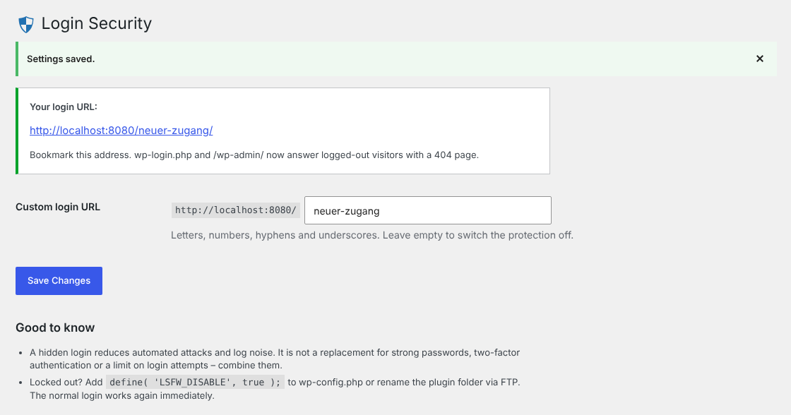

# Login Security – Custom Login URL

[](https://github.com/Christianzimpel/login-security-for-wp/actions/workflows/ci.yml)
[](https://wordpress.org/plugins/login-security-for-wp/)
[](https://wordpress.org/plugins/login-security-for-wp/)
[](LICENSE)

WordPress plugin that moves the login to a custom URL and answers requests to `wp-login.php` and `/wp-admin/` with a real 404 page.



## Features

- Custom login slug, e.g. `example.com/my-door/`. Works with and without pretty permalinks.
- `wp-login.php`, `wp-register.php`, `wp-signup.php` and `/wp-admin/` return **HTTP 404** for logged-out visitors (theme 404 template, no white screen).
- No leaks: `/login`, `/admin` and `/dashboard` no longer redirect to the login. Relative redirects inside `wp-login.php` are rewritten too.
- Password reset, registration, logout and e-mail links use the new URL automatically.
- Validation against reserved slugs and existing posts or pages.
- Emergency switch: `define( 'LSFW_DISABLE', true );` in `wp-config.php`.
- No rewrite rules, no custom tables, permalink settings stay untouched.

## How it works

| Hook | What happens |
| --- | --- |
| `plugins_loaded` (9999) | Parses `REQUEST_URI` before WordPress routes the request and flags a custom-login or blocked request. |
| `wp_loaded` (9999) | Loads `wp-login.php` for the custom slug, or renders a 404 for hidden entry points. |
| `site_url`, `network_site_url`, `wp_redirect` | Replace `wp-login.php` with the custom URL and keep the query string. |
| `template_redirect` | Core's `wp_redirect_admin_locations` is removed so `/login` cannot reveal the slug. |

## Development

```bash
composer install
composer lint      # WordPress Coding Standards
composer format    # auto-fix
```

Every push runs the coding standards, a PHP 7.4–8.4 syntax check and the official [Plugin Check](https://github.com/WordPress/plugin-check-action).

## Release

1. Bump `Version` in `login-security-for-wp.php`, `LSFW_VERSION`, `Stable tag` in `readme.txt` and add a changelog entry.
2. Publish a GitHub release with the version as tag (e.g. `2.0.1`).
3. The [deploy workflow](.github/workflows/deploy.yml) checks that tag and version match, pushes trunk, tag and assets to WordPress.org SVN and attaches the ZIP to the release.

Requires the repository secrets `SVN_USERNAME` and `SVN_PASSWORD`.

## Background

Version 2.0.0 is a rewrite based on a [code review in the WordPress.org support forum](https://wordpress.org/support/topic/code-optimizations/): the query-variable bypass, the white screen, the wrong `add_submenu_page()` parameters and the missing SVN tags and changelog are all fixed. See the [changelog](readme.txt).

## License

GPL-3.0-or-later © Christian Zimpel
